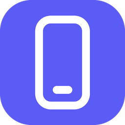
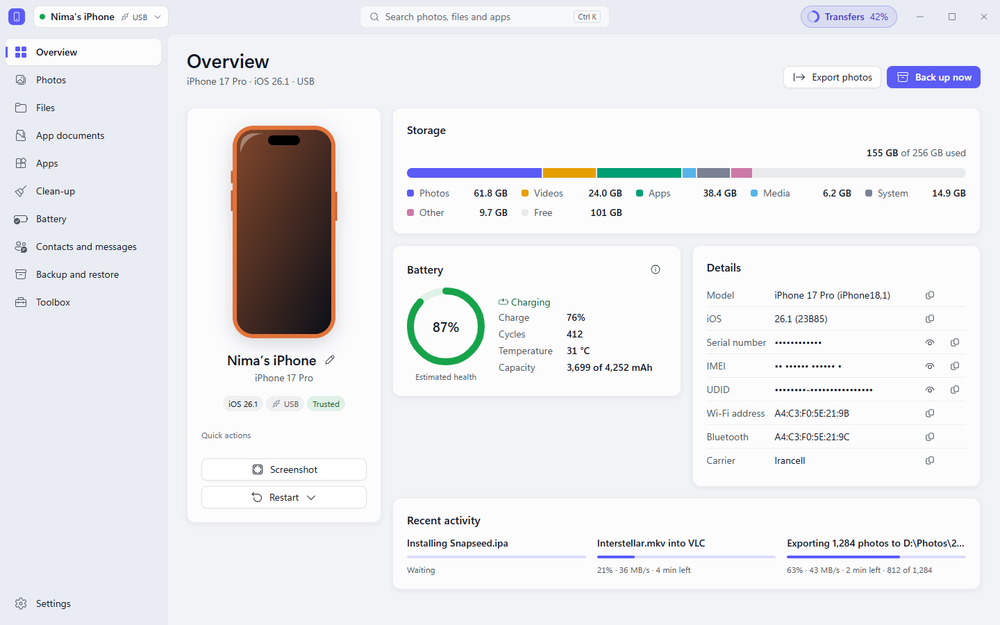
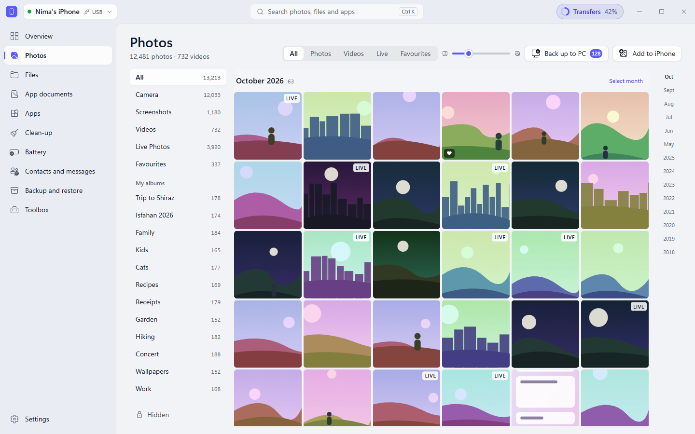
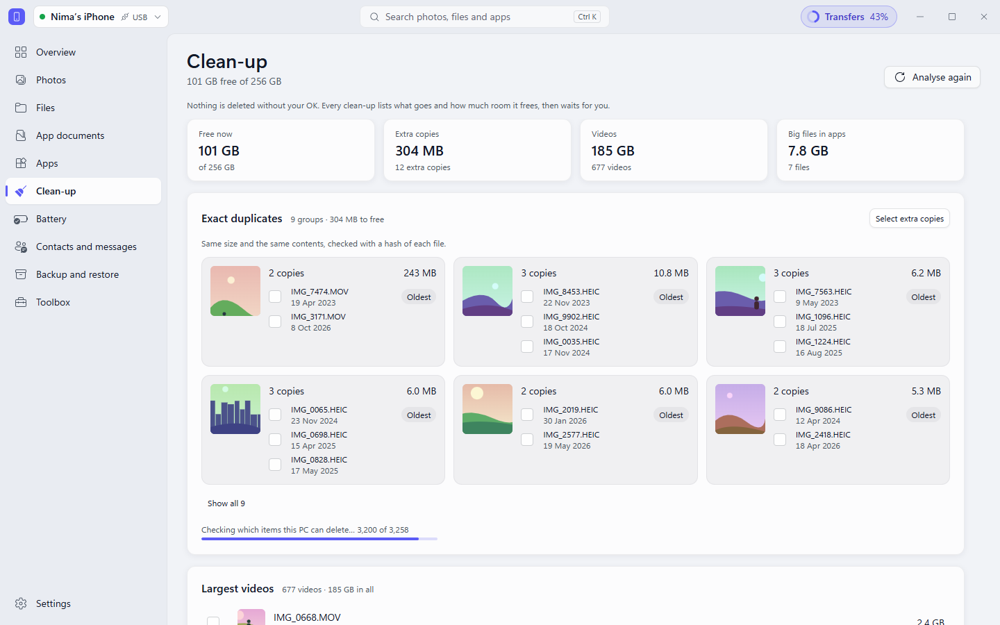
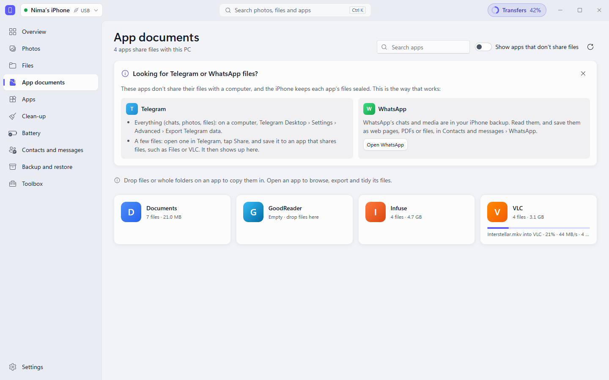
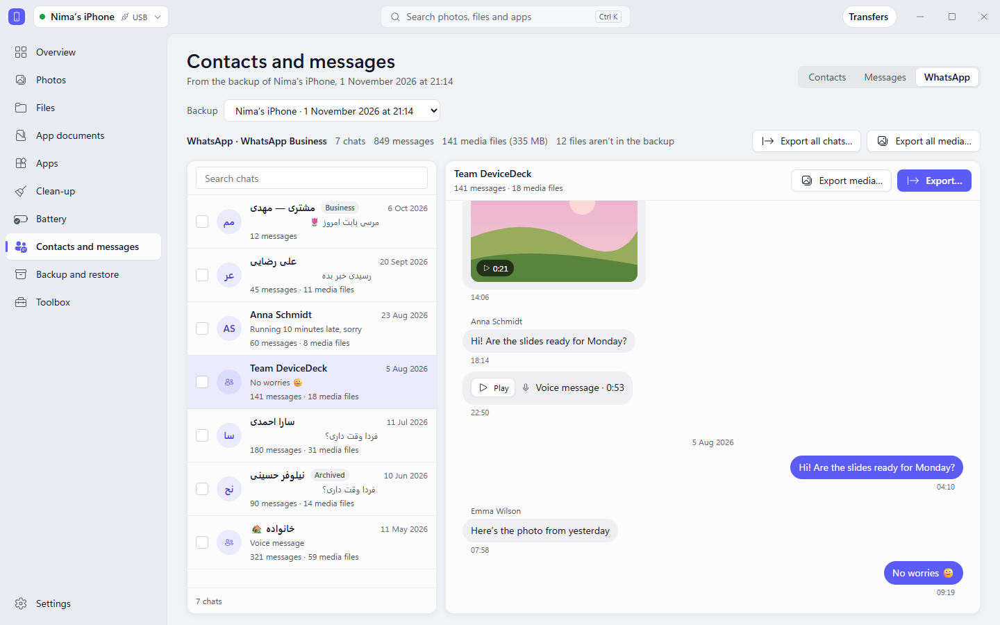
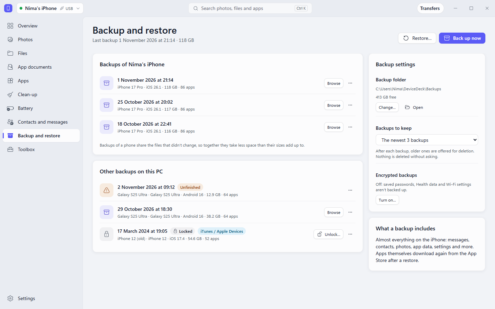
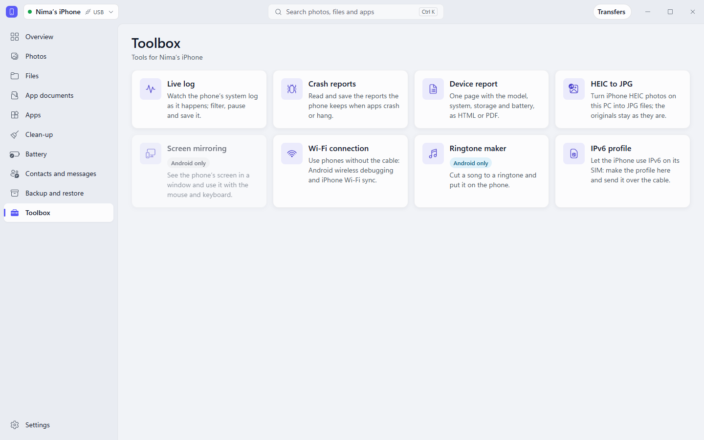
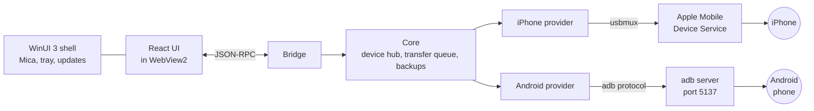
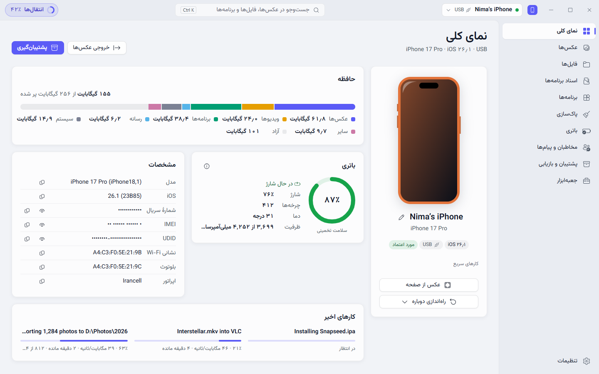

<div align="center">



# DeviceDeck

### Your iPhone and Android phone on Windows.<br>No iTunes window, no account, no cloud.

Photos, files, app documents, backups, clean-up and a toolbox, in one Mica-glass window.

[](https://github.com/sadrazkh/DeviceDeck/releases/latest)   

**[⬇️ Download](https://github.com/sadrazkh/DeviceDeck/releases/latest)** &nbsp;·&nbsp; **[📸 Screenshots](#-a-look-inside)** &nbsp;·&nbsp; **[✨ Features](#-what-it-does)** &nbsp;·&nbsp; **[❓ FAQ](#-questions)** &nbsp;·&nbsp; **[🇮🇷 فارسی](#farsi)**

<br>

<picture>
  <source media="(prefers-color-scheme: dark)" srcset="docs/images/overview-dark.png">
  
</picture>

</div>

## 🌟 Why DeviceDeck

- 🔌 **Plug in and go** — it finds the phone over USB and asks it to Trust this PC only when it has to.
- 🏠 **Stays on your PC** — no account and no cloud. All it fetches from the internet is update checks from GitHub and, if you ask for them, Google's Android tools.
- 🛡️ **Nothing goes without your OK** — every delete lists what goes and how much room it frees, and a restore asks you to type the phone's name first.
- 🚚 **One queue for everything** — copies, backups and deletes run in the background in Transfers. Pull the cable and a copy pauses; plug the same phone back in and it carries on.
- 🪟 **At home on Windows 11** — Mica, light and dark themes, and full Persian: the whole window mirrors, with Persian digits and the solar calendar.

## 📸 A look inside

<table>
  <tr>
    <td width="50%">
      <picture>
        <source media="(prefers-color-scheme: dark)" srcset="docs/images/photos-dark.png">
        
      </picture>
      <p align="center"><b>🖼️ Photos</b><br>Albums, favourites and Live Photos, with a timeline</p>
    </td>
    <td width="50%">
      <picture>
        <source media="(prefers-color-scheme: dark)" srcset="docs/images/cleanup-dark.png">
        
      </picture>
      <p align="center"><b>🧹 Clean-up</b><br>Duplicates, the largest videos and big files in apps</p>
    </td>
  </tr>
  <tr>
    <td width="50%">
      <picture>
        <source media="(prefers-color-scheme: dark)" srcset="docs/images/app-documents-dark.png">
        
      </picture>
      <p align="center"><b>📂 App documents</b><br>Files in and out of VLC and other apps that share files</p>
    </td>
    <td width="50%">
      <picture>
        <source media="(prefers-color-scheme: dark)" srcset="docs/images/whatsapp-dark.png">
        
      </picture>
      <p align="center"><b>💬 WhatsApp</b><br>Read and export chats from an iPhone backup</p>
    </td>
  </tr>
  <tr>
    <td width="50%">
      <picture>
        <source media="(prefers-color-scheme: dark)" srcset="docs/images/backup-dark.png">
        
      </picture>
      <p align="center"><b>💾 Backup and restore</b><br>Dated backups you can browse, encrypted if you like</p>
    </td>
    <td width="50%">
      <picture>
        <source media="(prefers-color-scheme: dark)" srcset="docs/images/toolbox-dark.png">
        
      </picture>
      <p align="center"><b>🧰 Toolbox</b><br>Live log, crash reports, HEIC to JPG, IPv6 profile and more</p>
    </td>
  </tr>
</table>

<sub>The screenshots use DeviceDeck's built-in sample data, not anyone's real phone. They switch between light and dark with your theme.</sub>

## ✨ What it does

| | 🍎 iPhone | 🤖 Android |
| --- | --- | --- |
| 📊 **Overview** | Model, storage by category, battery; serial and IMEI hidden until you reveal them | The same |
| 🖼️ **Photos** | The whole library: albums, favourites, Live Photos, screenshots, videos and a locked Hidden album | The whole gallery |
| 📸 **Photo backup** | Only what's new, never twice, into date folders; can start by itself when you plug in; hidden photos your way | Only what's new, the same way |
| ➕ **Photos to the phone** | Straight into Photos with the free LocalSend app, over the cable, or into an app that shares files | Straight into the gallery |
| 🗑️ **Deleting photos** | Through Windows' camera connection, with "Copy to this PC first" | ✅ |
| 📁 **Files** | The phone's media folder, beside your PC's folders | Internal storage and SD cards, beside your PC's folders |
| 📂 **App documents** | Any app that shares files: VLC, Documents, Infuse… | Each app's `Android/media`, plus the shared Documents and Download folders |
| 📦 **Apps** | List, uninstall, install an `.ipa` signed for the phone | List, uninstall, install `.apk` `.apks` `.xapk`, export an APK |
| 🧹 **Clean-up** | Biggest apps, largest videos and photos, duplicates, big files inside apps | The same, plus app caches |
| 🔋 **Battery history** | Health, cycles and capacity over time; health is labelled as an estimate | ✅ |
| 💾 **Backup** | Full or encrypted, picks up after a pulled cable, browse it, restore it | Apps (their APK files) and shared storage; no app data, contacts or messages |
| 👥 **Contacts and messages** | From a backup: contacts to vCard or CSV, each conversation to HTML or PDF | Needs a helper app, not there yet |
| 💬 **WhatsApp** | Read and export chats from a backup, encrypted ones too | Copies its media and backup files; the chats are locked with a key only the phone has |

### 🧰 Toolbox

| Tool | 🍎 | 🤖 | What it's for |
| --- | :---: | :---: | --- |
| 📜 **Live log** | ✅ | ✅ | Watch the phone's log as it happens; filter, pause and save it |
| 🐞 **Crash reports** | ✅ | ✅ | Read and save them; delete them on an iPhone |
| 📋 **Device report** | ✅ | ✅ | A one-page report of the phone, as PDF or HTML |
| 🖼️ **HEIC to JPG** | ✅ | ✅ | Converts files on your PC; no phone needed |
| 📶 **Wi-Fi** | ✅ | ✅ | iPhone: the "show on Wi-Fi" switch. Android: wireless pairing, by code or QR |
| 🌐 **IPv6 profile** | ✅ | | Lets an iPhone use IPv6 on its SIM, made on your PC instead of a website |
| 📱 **Screen mirroring** | | ✅ | The phone in a window, with your mouse and keyboard |
| 🎵 **Ringtones** | | ✅ | Cut a song and set it as the ringtone |

### 🪟 On the PC

- 📦 **Installer with automatic updates** — an "Update ready" button in the title bar, and a What's new window, in Persian when the app is.
- 🖱️ **Drag and drop, both ways** — from File Explorer onto a folder or an app, and from DeviceDeck out to File Explorer.
- 🔧 **A Drivers card that tells the truth** — says what's missing and gives you one button that gets it.
- 🔔 **Tray and notifications** — stays in the notification area and tells you when a phone connects or a backup ends.
- 🔎 **Search everything** — `Ctrl K` for photos, files and apps.

## ⬇️ Install

**1. Pick a download** from the [latest release](https://github.com/sadrazkh/DeviceDeck/releases/latest):

| | x64 (most PCs) | ARM64 |
| --- | --- | --- |
| 📦 **Setup** (recommended, updates itself) | `DeviceDeck-…-win-x64-Setup.exe` | `DeviceDeck-…-win-arm64-Setup.exe` |
| 🗜️ **Portable** (unzip and run) | `DeviceDeck-…-win-x64.zip` | `DeviceDeck-…-win-arm64.zip` |

**2. Get past SmartScreen.** DeviceDeck isn't signed yet, so Windows may warn the first time: **More info → Run anyway**. Each file has a `.sha256` beside it if you'd like to check it.

**3. Connect your phone.**

- 🍎 **iPhone** — needs Apple's USB driver, from the free Apple Devices app or iTunes. The Drivers card in Settings has the button. Tap **Trust** on the phone when it asks.
- 🤖 **Android** — turn on USB debugging and allow the PC on the phone. DeviceDeck can download Google's platform-tools for you and checks their signature.

You need Windows 11. Everything else DeviceDeck brings with it, so there's no .NET to install.

## 🤝 What it will never do

No jailbreak. No getting around iCloud, activation lock or FRP. No firmware flashing. It never skips the phone's Trust or permission prompts, and never works around a protection the phone or an app puts on its data.

## 🧪 How well it's tested

Every release passes 1,100+ .NET tests, 200+ web unit tests and 350+ browser tests, in light, dark and Persian, with a contrast check on the screens. Real phones are another matter, so here is where things stand:

| | |
| --- | --- |
| ✅ **On a real iPhone 16 (iOS 27)** | Overview, photos and albums, app documents, photo backup, deleting photos, sending photos with LocalSend, clean-up analysis, battery, live log, crash reports |
| 🧫 **On simulated phones only** | Full iPhone backup, restore and encryption; installing and removing apps; WhatsApp on real chats; the IPv6 profile |
| 🧫 **Android** | Every feature is tested against recorded outputs and simulated phones, not yet on a real one |

Found something? [Open an issue](https://github.com/sadrazkh/DeviceDeck/issues). A report from the Toolbox's Device report helps a lot; serial numbers stay hidden in it unless you choose to show them.

## ❓ Questions

<details>
<summary><b>Do I need iTunes?</b></summary>
<br>
You need Apple's USB driver, which comes with either the free Apple Devices app or iTunes. You never have to open them.
</details>

<details>
<summary><b>Why does adding photos to an iPhone need LocalSend?</b></summary>
<br>
An iPhone doesn't let a PC write into Photos over USB. The free LocalSend app on the phone can, and DeviceDeck talks to it over the same cable, or over Wi-Fi. There's a walkthrough inside the app. Without it, photos can go into any app that shares files.
</details>

<details>
<summary><b>Why does a photo say "Delete on the iPhone"?</b></summary>
<br>
Windows doesn't show a PC every photo on an iPhone; ones moved over from an earlier iPhone are often hidden from it. Those can only be deleted in the Photos app, and DeviceDeck marks them up front.
</details>

<details>
<summary><b>Why does the battery health differ from what iOS shows?</b></summary>
<br>
DeviceDeck works it out from the capacity the phone reports, so it's labelled as an estimate. iOS Settings has its own way of counting and may show a different number.
</details>

<details>
<summary><b>Can it read Telegram or WhatsApp files directly on an iPhone?</b></summary>
<br>
No, those apps keep their files to themselves. App documents has a guide to the official ways out: Telegram Desktop's export, and the WhatsApp section, which reads chats from a backup.
</details>

<details>
<summary><b>Will it disturb my other adb?</b></summary>
<br>
No. DeviceDeck runs adb on its own port (5137), and stops it when it closes.
</details>

## 🛠️ For developers

<details>
<summary><b>How it's built, and how to build it</b></summary>
<br>

A WinUI 3 window hosts a React page in WebView2, and the two talk JSON-RPC. The phone protocols are written here: usbmux, lockdown, AFC, house_arrest and mobilebackup2 for an iPhone, and adb's wire protocol for Android.



| Folder | What's in it |
| --- | --- |
| `src/DeviceDeck.Shell` | WinUI 3 window, Mica, WebView2 host, tray, updates |
| `src/DeviceDeck.Bridge` | JSON-RPC between the page and the host |
| `src/DeviceDeck.Core` | Shared abstractions, device hub, transfer queue, backups |
| `src/DeviceDeck.Ios` | iPhone provider |
| `src/DeviceDeck.Android` | Android provider |
| `web/` | React UI and a mock backend that runs in any browser |
| `tools/` | Probes to run with a phone plugged in, packaging, downloads |
| `tests/` | Unit tests with captured fixtures and fake phones |

You need Windows 11, the .NET 10 SDK and Node 22.

```powershell
dotnet build DeviceDeck.slnx
dotnet test DeviceDeck.slnx
```

```powershell
cd web
npm ci
npm run build
npm test
```

- 🧪 **No phone?** Set `DEVICEDECK_PROVIDERS=fake` for sample phones in the real app, or run `npm run dev` in `web/` to see the UI in a browser against the mock backend.
- 🤖 **adb and scrcpy-server** aren't in the repo: `tools/fetch-platform-tools.ps1` and `tools/fetch-scrcpy-server.ps1` fetch them into `third_party/`.
- 📦 **A release** is a pushed `vX.Y.Z` tag: CI tests it, builds x64 and ARM64 with `tools/package.ps1`, and publishes with the notes from `docs/releases/`.
- 📚 **More:** [the page ↔ host contract](docs/bridge-contract.md), [code signing](docs/code-signing.md), [release notes](docs/releases), [working rules](CLAUDE.md).

</details>

## 🙏 Built with

[.NET](https://dotnet.microsoft.com) · [WinUI 3](https://github.com/microsoft/microsoft-ui-xaml) · [React](https://react.dev) · [Radix UI](https://www.radix-ui.com) · [Fluent UI icons](https://github.com/microsoft/fluentui-system-icons) · [Velopack](https://velopack.io) · [scrcpy](https://github.com/Genymobile/scrcpy) · [Vazirmatn](https://github.com/rastikerdar/vazirmatn) · and works with [LocalSend](https://localsend.org). The protocol work leans on what [libimobiledevice](https://github.com/libimobiledevice/libimobiledevice) and [pymobiledevice3](https://github.com/doronz88/pymobiledevice3) documented. The full list is in [THIRD-PARTY-NOTICES](THIRD-PARTY-NOTICES.md).

<a id="farsi"></a>

---

<details>
<summary><b>🇮🇷 فارسی</b></summary>
<br>

<div dir="rtl">

<div align="center">

<h1>دیوایس‌دک</h1>

<h3>آیفون و گوشی اندرویدت روی ویندوز.<br>بدون پنجرهٔ iTunes، بدون حساب کاربری، بدون فضای ابری.</h3>

عکس‌ها، فایل‌ها، اسناد برنامه‌ها، پشتیبان‌گیری، پاک‌سازی و جعبه‌ابزار، همه در یک پنجرهٔ شیشه‌ای.

**[⬇️ دانلود آخرین نسخه](https://github.com/sadrazkh/DeviceDeck/releases/latest)**



</div>

## 🌟 چرا دیوایس‌دک

- 🔌 **وصل کن و شروع کن** — گوشی را از راه USB پیدا می‌کند و فقط وقتی لازم باشد از گوشی می‌خواهد به این کامپیوتر اعتماد کند.
- 🏠 **همه‌چیز روی کامپیوتر خودت** — نه حساب کاربری می‌خواهد و نه فضای ابری. تنها چیزهایی که از اینترنت می‌گیرد بررسی آپدیت از GitHub است و، اگر بخواهی، ابزارهای اندروید گوگل.
- 🛡️ **هیچ چیز بدون اجازهٔ تو حذف نمی‌شود** — هر حذف می‌گوید چه چیزی می‌رود و چقدر جا آزاد می‌شود، و برای بازیابی باید اسم گوشی را تایپ کنی.
- 🚚 **یک صف برای همه‌چیز** — کپی، پشتیبان‌گیری و حذف در پس‌زمینه و در «انتقال‌ها» انجام می‌شوند. اگر کابل جدا شود کپی متوقف می‌شود و با وصل شدن همان گوشی ادامه پیدا می‌کند.
- 🪟 **هماهنگ با ویندوز ۱۱** — جلوهٔ Mica، تم روشن و تیره، و فارسی کامل: پنجره راست‌به‌چپ می‌شود، با اعداد فارسی و تقویم شمسی.

## ✨ چه کارهایی می‌کند

| | 🍎 آیفون | 🤖 اندروید |
| --- | --- | --- |
| 📊 **نمای کلی** | مدل، حافظه به تفکیک، باتری؛ شماره سریال و IMEI تا وقتی نخواهی پنهان‌اند | همین‌طور |
| 🖼️ **عکس‌ها** | کل کتابخانه: آلبوم‌ها، علاقه‌مندی‌ها، Live Photo، اسکرین‌شات، ویدیو و آلبوم قفل‌شدهٔ Hidden | کل گالری |
| 📸 **پشتیبان عکس** | فقط عکس‌های جدید، هیچ‌وقت دو بار، در پوشه‌های تاریخ‌دار؛ می‌تواند با وصل شدن گوشی خودش شروع شود | فقط عکس‌های جدید، به همین شکل |
| ➕ **عکس به گوشی** | مستقیم به Photos با برنامهٔ رایگان LocalSend از راه کابل، یا به برنامه‌ای که فایل می‌پذیرد | مستقیم به گالری |
| 🗑️ **حذف عکس** | از راه اتصال دوربین ویندوز، با گزینهٔ «اول کپی به این کامپیوتر» | ✅ |
| 📁 **فایل‌ها** | پوشهٔ رسانهٔ گوشی، کنار پوشه‌های کامپیوتر | حافظهٔ داخلی و کارت SD، کنار پوشه‌های کامپیوتر |
| 📂 **اسناد برنامه‌ها** | هر برنامه‌ای که فایل به اشتراک می‌گذارد: VLC، Documents، Infuse و… | پوشهٔ `Android/media` هر برنامه، و پوشه‌های مشترک Documents و Download |
| 📦 **برنامه‌ها** | فهرست، حذف، نصب `.ipa` امضاشده برای همان گوشی | فهرست، حذف، نصب `.apk` و `.apks` و `.xapk`، خروجی APK |
| 🧹 **پاک‌سازی** | بزرگ‌ترین برنامه‌ها، ویدیوها و عکس‌ها، تکراری‌ها، فایل‌های بزرگ داخل برنامه‌ها | همین‌طور، به‌علاوهٔ کش برنامه‌ها |
| 🔋 **تاریخچهٔ باتری** | سلامت، چرخه‌ها و ظرفیت در طول زمان؛ سلامت به عنوان تخمین نشان داده می‌شود | ✅ |
| 💾 **پشتیبان** | کامل یا رمزدار، بعد از جدا شدن کابل ادامه می‌دهد، قابل مرور و بازیابی | برنامه‌ها (فایل APK) و حافظهٔ مشترک؛ بدون دادهٔ برنامه‌ها، مخاطبان و پیام‌ها |
| 👥 **مخاطبان و پیام‌ها** | از روی پشتیبان: مخاطبان به vCard یا CSV، هر گفتگو به HTML یا PDF | به یک برنامهٔ کمکی نیاز دارد که هنوز آماده نیست |
| 💬 **واتس‌اپ** | خواندن و خروجی گرفتن از گفتگوها از روی پشتیبان، حتی رمزدار | کپی رسانه‌ها و فایل‌های پشتیبانش؛ خود گفتگوها با کلیدی قفل‌اند که فقط گوشی دارد |

**🧰 جعبه‌ابزار:** لاگ زنده، گزارش کرش، گزارش دستگاه، تبدیل HEIC به JPG، تنظیم Wi-Fi، پروفایل IPv6 (آیفون)، نمایش صفحهٔ گوشی و ساخت زنگ (اندروید).

## ⬇️ نصب

1. از [آخرین نسخه](https://github.com/sadrazkh/DeviceDeck/releases/latest) فایل `Setup.exe` را بگیر (خودش آپدیت می‌شود) یا `zip` قابل‌حمل را. برای بیشتر کامپیوترها نسخهٔ `x64` درست است.
2. برنامه هنوز امضا نشده، پس SmartScreen ممکن است بار اول هشدار بدهد: **More info ← Run anyway**.
3. **آیفون:** درایور USB اپل لازم است که با برنامهٔ رایگان Apple Devices یا iTunes نصب می‌شود؛ کارت درایورها در تنظیمات دکمه‌اش را دارد. وقتی گوشی پرسید **Trust** را بزن.
4. **اندروید:** USB debugging را روشن کن و روی گوشی به کامپیوتر اجازه بده. دیوایس‌دک خودش می‌تواند ابزار platform-tools گوگل را دانلود کند.

به ویندوز ۱۱ نیاز داری و بقیه‌اش همراه خود برنامه است؛ لازم نیست .NET نصب کنی.

## 🤝 کارهایی که هیچ‌وقت نمی‌کند

جیلبریک نمی‌کند. قفل iCloud، Activation Lock یا FRP را دور نمی‌زند. فلش فریمور نمی‌کند. پیام‌های Trust و اجازهٔ گوشی را رد نمی‌کند و هیچ محافظتی را که گوشی یا برنامه‌ای روی داده‌هایش گذاشته دور نمی‌زند.

## 🧪 چقدر تست شده

هر نسخه از بیش از ۱۱۰۰ تست .NET، بیش از ۲۰۰ تست واحد وب و بیش از ۳۵۰ تست مرورگر رد می‌شود. ولی گوشی واقعی داستان دیگری است:

- ✅ **روی آیفون ۱۶ واقعی (iOS 27):** نمای کلی، عکس‌ها و آلبوم‌ها، اسناد برنامه‌ها، پشتیبان عکس، حذف عکس، فرستادن عکس با LocalSend، بررسی پاک‌سازی، باتری، لاگ زنده و گزارش کرش.
- 🧫 **فقط با گوشی شبیه‌سازی‌شده:** پشتیبان کامل و بازیابی و رمزگذاری آیفون، نصب و حذف برنامه، واتس‌اپ روی گفتگوهای واقعی، پروفایل IPv6.
- 🧫 **اندروید:** همهٔ قابلیت‌ها با خروجی‌های ضبط‌شده و گوشی شبیه‌سازی‌شده تست شده‌اند، هنوز نه روی گوشی واقعی.

مشکلی دیدی؟ [یک Issue باز کن](https://github.com/sadrazkh/DeviceDeck/issues).

</div>

</details>
